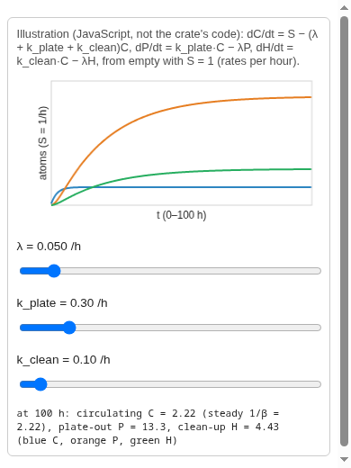

# Step 15 — A loss-of-cooling accident, and what TRISO-ATOPS leaves out

> **Research, education and V&V only.** Not for reactor operation, licensing, safety decisions or emergency response.
> **Review status: first draft, 2026-10-18, AI-assisted (Claude Sonnet), not yet reviewed by a human.**

**The question this page answers.** [Step 14](./14-triso-atops.md) gave a
cheap model of normal operation. *What physically happens in a
depressurised loss-of-forced-cooling (DLOFC) accident, which parts of that
does TRISO-ATOPS keep, and which does it leave out?*

## 1. The physical sequence

The sequence below is the one the repo's own pages describe. Where a step is
standard physics the repo does not source, it is marked.

1. **The primary boundary opens.** In the HTR-10 stage of the digital twin
   the primary depressurises through a ruptured DN65 fuel-loading tube at
   the top of the vessel, at an initial discharge of 6.58 kg/s and a total
   of about 150 kg, taken from Gao & Shi (2002) section 5.3.1
   ([`depressurisation.rs`](https://github.com/theodoreOnzGit/outram-park-backend/blob/@@COMMIT@@/crates/outram-park-digital-twin-engine/examples/htgr_sim_v1/physics/depressurisation.rs)).
   The shape of the discharge in time is assumed, labelled as such there.
2. **The helium leaves, and takes circulating activity with it.** Pressure
   drops, gas accelerates through the break, and surfaces see high shear.
   This is where lift-off acts (Step 12).
3. **The circulator stops.** Forced cooling is lost.
4. **The core heats.** Decay heat continues after shutdown (textbook physics,
   not sourced in the repo), and with no forced flow the core temperature rises
   over hours to days, with heat leaving by conduction and radiation. The
   tutorial describes it as "the core heats for days, and diffusion speeds up"
   and the repo's DLOFC example heats for 30 h
   ([`coolant.md`](../triso-atops/coolant.html), step 3 and step 4).
5. **Diffusion speeds up.** The diffusion coefficient $D(T)$ of Steps 5 to 7
   is Arrhenius in temperature, so hot fuel releases far more than cold fuel.
6. **Some particles fail.** Pressure and SiC decomposition (Step 9) raise the
   failed fraction as the temperature climbs.
7. **The gas expands as it heats.** If any helium or air remains, heating
   pushes some of it out of the break.
8. **Air or water may enter** through the break once the pressure is low
   (Step 15, section 4).
9. **Later, the core cools slowly.** Release by venting stops.

## 2. What TRISO-ATOPS does with it

The accident path is a set of **pieces**, composed by the caller
([`release_activity`](../../code-review/#crates/boon-lay/src/triso_atops_fork/accident/mod.rs::release_activity)):

| Physical step | What TRISO-ATOPS does |
|---|---|
| Diffusion at changing temperature | Integrates $\int D dt$ over the temperature history ([`integrate_diffusion_over_time`](../../code-review/#crates/boon-lay/src/triso_atops_fork/diffusion/mod.rs::integrate_diffusion_over_time)) |
| Release from fuel | Transient Booth, breakthrough and graph models by group ([`release_fraction_transient`](../../code-review/#crates/boon-lay/src/triso_atops_fork/release_models/mod.rs::release_fraction_transient)) |
| Gas leaves the core | The fraction **vented by thermal expansion** while the core heats |
| Circulating activity leaves | All of it leaves at once |
| Plate-out is torn off | A fraction $x_{liftoff}$ of the plate-out leaves at once |

The vented fraction of an ideal gas heated from $T_0$ to $T_{peak}$ at
constant pressure tends to

$$f_{vent} = 1 - \frac{T_0}{T_{peak}}$$

and is counted only at samples where the core is **heating**
($dT/dt \geq 0$)
([`coolant_release`](../../code-review/#crates/boon-lay/src/triso_atops_fork/accident/mod.rs::coolant_release)).
The released activity in curies is

$$A_{rel} = f_{vent}(A_{kernel} + A_{graphite}) + A_{circ} + x_{liftoff} A_{plate}$$

([`accident_release_curies`](../../code-review/#crates/boon-lay/src/triso_atops_fork/accident/mod.rs::accident_release_curies)).
The first term is scaled by venting; the second and third are not, and are
constant in time.

**The simplifications, each with its price.**

- **Release only by venting.** *Judgement:* in a depressurised hot core the
  gas that can carry activity out is the gas that expands. *Fails:* when gas
  flows through the core while it is not heating. A flat hold releases **zero**:
  the recorded test of a 1400 C isothermal hold for 140 h with a full-failure
  fraction of $2.0 \times 10^{-3}$ released 0 Bq for every nuclide (gh:#446,
  found 2026-09-30, recorded, not re-run).
- **Circulating activity leaves all at once**, with no time dependence. This
  errs high on release for the circulating pool.
- **Lift-off is one number**, independent of blowdown speed and surface.
- **Temperatures come from outside**: the accident history is an input.
  TRISO-ATOPS does not compute the heat-up.

**CORRECTED 2026-10-18** (Step 20 review of `htgr_sim_v1`): the digital twin does not take this accident path. It vents the live pools instead, as [Step 20](./20-htgr-sim-v1-chain.md) section 6 shows.

## 3. The pools picture

The three pools of the normal-operation model, filling from empty with a
constant source, are the picture that makes plate-out and purification
visible. Move the sliders: raise $k_{plate}$ and the orange plate-out pool
grows while the blue circulating pool shrinks.

<link rel="stylesheet" href="../triso-atops/anim/boonlay-anim.css">

If the widget does not appear (it needs the published site; a local `mdbook
build` of this book alone does not carry the tutorial's script), the image
below is a screenshot of the same widget, taken with headless Chromium at
390 pixels wide.

The widget is the tutorial's own illustration, in JavaScript, not the crate's
Rust code. The crate's code is computed in the browser by the tutorial's demo,
at its [release rung](../../demos/triso-atops/?rung=release). That demo carries
the same pools for the HTR-10 nuclides, as a live diagram from the particle to
the circulating helium, plate-out and purification pools.

## 4. What TRISO-ATOPS does **not** simulate

Checked against the fork's code and docs. "Not modelled" gives the evidence.
"Partly" says what is there.

| Item | Status | Evidence |
|---|---|---|
| **Lift-off** | Partly | One fraction $x_{liftoff}$ of the plate-out, released at once in `accident_release_curies`. No dependence on gas velocity, surface or time. The value is a stand-in |
| **Dust** | Not modelled | The fork's module doc: "No building, dust or helium-purification-system term"; no use of dust anywhere in its source |
| **Water ingress** | Not modelled in the fork | `accident/mod.rs`: "There is no air- or water-ingress transport". The workspace has three chemistry correlations in `boon_lay::chemistry` (steam on graphite, air on graphite, steam on exposed kernels), and the digital twin's water-ingress stage adds steam-generator wash-off. None feed the fork's accident formula |
| **Air ingress** | Not modelled in the fork | Same doc. `sembawang`'s flow-through venting modes add one, labelled not upstream |
| **Chemistry-dependent sorption** | Not modelled | One $k_{plate}$ per group, or per element in `triso_atops_extensions`; no temperature, surface or species-chemistry dependence |
| **Spatial variation around the circuit** | Partly | Core nodes have their own temperatures. The coolant pools have no position |
| **Purification in the accident** | Not modelled in the fork | "no ... helium-purification-system term". The digital twin adds an assumed purification release |
| **Building** | Not modelled | No term. See Step 16 |
| **Time-varying leak** | Partly | Not upstream; a constant $k_{leak}$ in `live_pools.rs` |
| **Heat-up** | Not modelled | The temperature history is an input |

The water-ingress stage that the digital twin builds on top is a good example
of how a cheap model is *extended*: it carries a gas-composition balance, the
chemistry correlations, relief-valve opening pressures from Gao & Shi (2002),
and the steam-generator wash-off fractions (Cs 73 %, Sr 80 %, I 100 %, Liu &
Cao 2002, after Wolters et al. 1985, as the code cites)
([`water_ingress.rs`](https://github.com/theodoreOnzGit/outram-park-backend/blob/@@COMMIT@@/crates/outram-park-digital-twin-engine/examples/htgr_sim_v1/physics/water_ingress.rs)).
It is *not* part of TRISO-ATOPS, and the tutorial's chemistry rung says the
chemistry is "the thinnest rung in the crate": three transcribed rate laws, not
a mechanistic attack model.

## Why each simplification is allowed

**Kinds of justification used below.** (a) negligible effect, with an estimate; (b) computationally too expensive to be practical; (c) bounding or conservative, with the side it errs on; (d) data not available. **Open** means this page cannot justify it.

| Simplification | Kind | Justification |
|---|---|---|
| Release only by venting | **Open**, and known to fail | The isothermal hold releases zero: a hole, not a bound. gh:#446 |
| Circulating activity leaves at once | (c) | Errs high on release |
| Lift-off one fraction | (d) | Stand-in value |
| Heat-up taken as input | (b) | Computing it is a separate thermal-hydraulic problem |
| Water and air ingress omitted from the fork | (d) and (b) | Chemistry is three transcribed correlations; a mechanistic model is not built |
| Dust omitted | (d) | No data in the repo |

## What we assumed

- Heat-up is an input history.
- Release leaves only by venting while heating.
- Circulating activity and a fixed share of plate-out leave at once.
- Everything the table marks "not modelled" is zero in the accident formula.

## Next question

Activity leaving the vessel is not yet activity leaving the plant. What is
outside the vessel, and which parts of it may we **not** credit?
[Step 16](./16-building-and-bounds.md).
